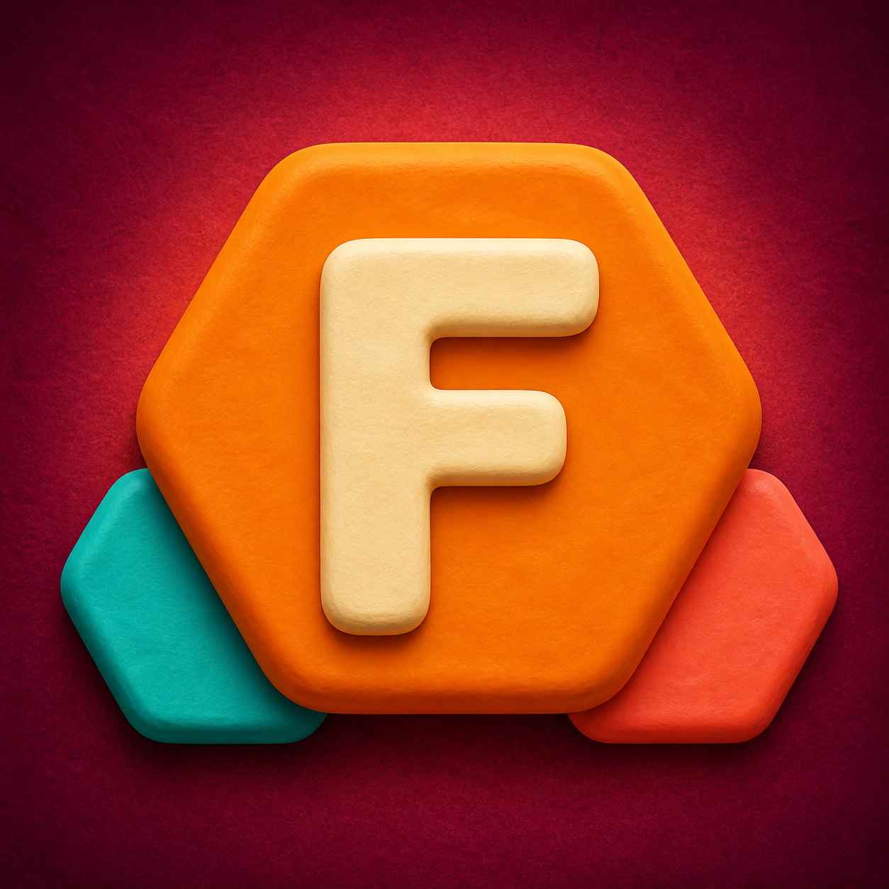

<div align="center">
  
  <h1>Fudu Hex</h1>
  <p><strong>A tactile, level-based number-merging puzzle for iOS and Android.</strong></p>
  <p>
    
    
    
    
  </p>
</div>

## Overview

Fudu Hex is a mobile puzzle game built with Expo and React Native. Players trace a path through neighbouring hexagonal tiles, combine compatible values, and work toward a level target. The interaction is designed around responsive touch input, clear visual feedback, and short, satisfying merge animations.

The project covers the complete mobile-game flow: onboarding, persistent progress, procedural level generation, sound and music controls, localization, monetization hooks, App Store review prompts, and production builds with EAS.

<div align="center">
  
  
</div>

## Highlights

- Six-direction hex-grid path selection with drag and backtracking support
- Chain-merging rules that accept compatible powers of two
- Animated tile selection, merging, gravity, refill, and level transitions
- Four-step interactive tutorial and first-launch language selection
- Progressive level system with weighted tile generation and automatic reshuffling
- Local save data for board state, score, level, language, audio preferences, and tutorial progress
- Responsive portrait layout using safe areas and runtime screen measurements
- Turkish and English localization
- Procedurally generated music and sound effects with independent controls
- Google Mobile Ads integration with consent handling, test IDs in development, banner ads, and level-completion interstitials
- Native iOS App Store review prompt shown at controlled progression intervals

## Gameplay progression

| Level | Available values | Goal |
| --- | --- | ---: |
| 1 | 2, 4, 8 | 128 |
| 2 | 2, 4, 8, 16 | 256 |
| 3 | 2, 4, 8, 16, 32 | 512 |
| 4 | 2, 4, 8, 16, 32, 64 | 1,024 |
| 5+ | Six shifting values | Doubles each level |

Higher-value tiles are intentionally less common. If the board has no valid move, the game creates a playable shuffle instead of ending the run.

## Tech stack

- React Native 0.81 and React 19
- Expo SDK 54 and EAS Build
- React Native SVG for the hexagonal board and visual effects
- React Native Animated for interactions and transitions
- AsyncStorage for local persistence
- Expo Audio for music and sound effects
- Expo Store Review for the native iOS rating prompt
- React Native Google Mobile Ads for consent-aware monetization

## Getting started

Requirements: Node.js 20 or newer, npm, and the Expo Go app for basic gameplay testing.

```bash
npm install
npx expo start
```

Scan the QR code with Expo Go while the phone and development computer are on the same network. Expo Go can run the gameplay experience, but native modules such as AdMob require a development build.

Useful commands:

```bash
npm run android
npm run ios
npm run check
npm run generate:audio
npm run generate:selection-sound
```

## Production configuration

The repository contains only Google's official test application IDs. Account-specific AdMob unit IDs and the EAS project ID are read from environment variables.

1. Copy `.env.example` to `.env.local`.
2. Add your own EAS and AdMob identifiers.
3. Store the same production values in EAS environment variables before creating a store build.
4. Never commit Apple certificates, App Store Connect keys, Android keystores, service-account JSON files, or `.env.local`.

Development builds always request Google test ads. If production ad variables are absent, the app displays its built-in ad placeholder rather than loading a test unit in a store release.

## Project structure

```text
.
├── App.js                         # Game state, interaction, screens and animation flow
├── ads.js                         # Consent-aware banner/interstitial integration
├── app.config.js                  # Expo metadata and environment-based identifiers
├── assets/                        # App art, branding, music and sound effects
├── scripts/                       # Reproducible procedural audio generators
├── eas.json                       # Development, preview and production build profiles
└── .env.example                   # Documented environment variable names
```

## Privacy and repository safety

Game progress and preferences are stored locally on the device. The repository excludes local dependencies, caches, store assets, build outputs, environment files, signing credentials, and service configuration files through `.gitignore`.

AdMob may process advertising and device-related data according to the consent state and Google's policies. Store privacy disclosures should always match the SDK version and production configuration used in the submitted build.

## Status

The game is feature-complete for its current mobile release. Future work can focus on automated interaction tests, additional accessibility options, and extracting the main game screen into smaller reusable modules.

## Author

Designed and developed by **Görsen Games**.

© 2026 Görsen Games. All rights reserved.
